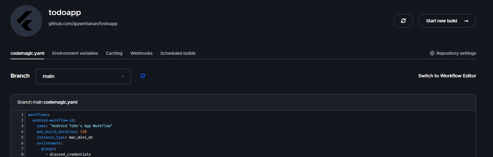
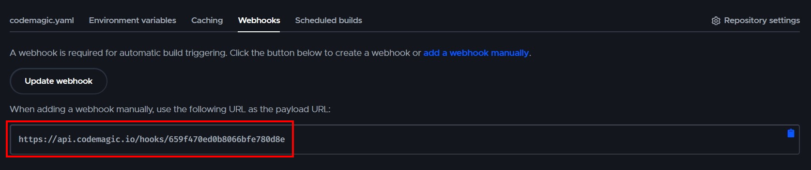
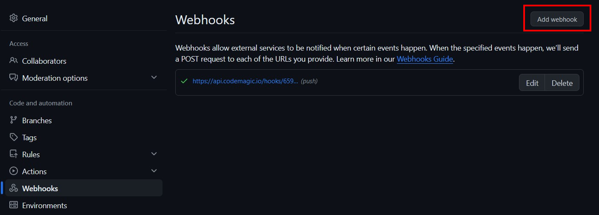
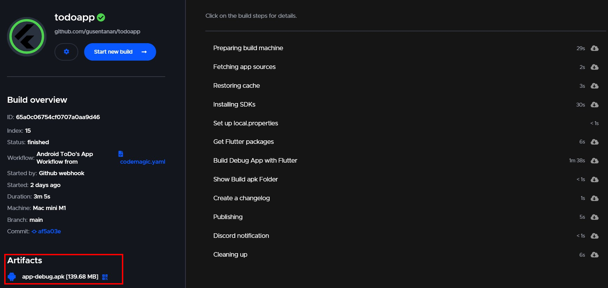
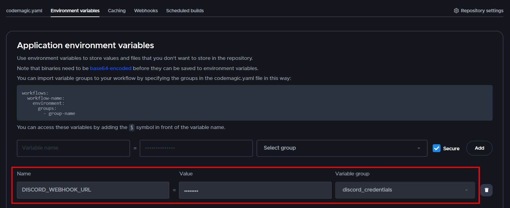
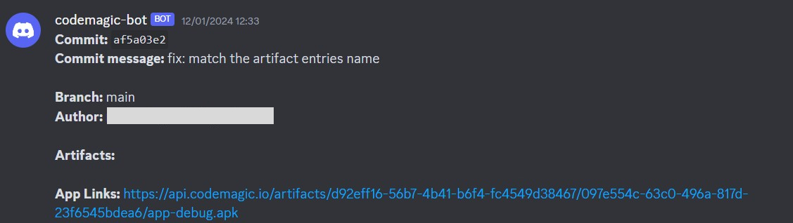

Building a mobile app on your own machine works fine until someone else on the team tries to build it. Different Flutter versions, different Java versions, and different machine setups lead to builds that work for one person and break for another. A CI/CD service fixes this by building the app the same way every time, on a clean machine.

In this post I'll set up Codemagic to build a Flutter Android app on every push, then send a Discord notification when each build finishes.

Codemagic started as a Flutter-only service. It now also supports native Android, native iOS, and React Native, with plenty of advanced configuration. It has a free tier, so it's easy to try.

> When I wrote this, the free tier gave you 500 build minutes per month on Codemagic's M1 Mac machines. Use them wisely.

### Setting up a Codemagic account and GitHub repository
Sign up for Codemagic with the service that hosts your repository. I'm using GitHub in this post.

After signing up, open the Codemagic dashboard and click "Add application". Choose the individual plan, paste the link to the GitHub repository you want to connect, and click "Finish: Add application".

There are two ways to configure a workflow. You can write a `codemagic.yaml` file, or use the workflow editor in the dashboard. I prefer the YAML file. It lives in the repository next to the code, and writing it taught me some scripting.

Here's what the dashboard looks like after you add the repository.



Before writing `codemagic.yaml`, connect Codemagic to your repository with a webhook, so that pushes on GitHub can trigger builds. Open your application in the Codemagic dashboard and copy its webhook URL.



Then go to your GitHub repository, open Settings > Webhooks, and add the Codemagic webhook URL.



Codemagic and GitHub are now connected.

### Creating your `codemagic.yaml`
We'll start with the simplest setup that works and add to it step by step.

First, define a workflow ID, a display name, the maximum build duration in minutes, and the machine to run on. Use hyphens to separate words in the ID.
```yaml
workflows:
  android-workflow-id:                    # your workflow ID
    name: "Android ToDo's App Workflow"
    max_build_duration: 120               # max duration of your build, in minutes
    instance_type: mac_mini_m1            # remote machine to run your workflow
```

Next is `environment`, where you set the tool versions your project needs, such as Flutter and Java.
```yaml
workflows:
  android-workflow-id:
    ...
    environment:          # tool versions for the build
      flutter: stable     # or pin a version, like 3.0.5
      java: 17
```

`triggering` decides which events in your GitHub repository start a build. Codemagic has four trigger events. These are the three I use most.
- `push` starts a build every time you push commits to a tracked branch.
- `pull_request` starts a build when a pull request is opened or updated, to check the resulting merge commit.
- `tag` builds the tagged commit whenever you create a tag.
```yaml
workflows:
  android-workflow-id:
    ...
    triggering:
      events:
        - push              # trigger on push events
      branch_patterns:
        - pattern: "*"      # match every branch (main, dev, and so on)
          include: true
          source: true
```
> For pull request triggers, `source` decides whether the pattern matches the pull request's source branch or its target branch.

You can read more about `triggering` in the Codemagic docs linked at the end of this post.

Next is `scripts`, the commands that build your app. They run from top to bottom, so order matters.

Knowing basic Linux shell commands helps a lot here, especially when you need to debug a failed build.
```yaml
workflows:
  android-workflow-id:
    ...
    scripts:
      - name: Set up local.properties
        script: |
          echo "flutter.sdk=$HOME/programs/flutter" > "$CM_BUILD_DIR/android/local.properties"
      - name: Get Flutter packages
        script: |
          flutter packages pub get
      - name: Build Debug App with Flutter
        script: |
          flutter build apk --debug
      - name: Show Build apk Folder  # lists the build output, handy for debugging
        script: |
          ls build/app/outputs/flutter-apk
```

Finally, `artifacts` lists the build outputs to keep, and `publishing` decides where to send them.
```yaml
workflows:
  android-workflow-id:
    ...
    artifacts:
      - build/app/outputs/flutter-apk/*.apk  # path to the files to keep
    publishing:
      email:
        recipients:
          - example@gmail.com  # who gets the build report
```

Here's the full `codemagic.yaml`. I also added `cache`, which keeps your pub packages between builds so they don't download every time.
```yaml
workflows:
  android-workflow-id:
    name: "Android ToDo's App Workflow"
    max_build_duration: 120
    instance_type: mac_mini_m1
    environment:
      flutter: stable
      java: 17
    cache:
      cache_paths:
        - ~/.pub-cache
    triggering:
      events:
        - push
      branch_patterns:
        - pattern: "*"
          include: true
          source: true
    scripts:
      - name: Set up local.properties
        script: |
          echo "flutter.sdk=$HOME/programs/flutter" > "$CM_BUILD_DIR/android/local.properties"
      - name: Get Flutter packages
        script: |
          flutter packages pub get
      - name: Build Debug App with Flutter
        script: |
          flutter build apk --debug
      - name: Show Build apk Folder
        script: |
          ls build/app/outputs/flutter-apk
    artifacts:
      - build/app/outputs/flutter-apk/*.apk
    publishing:
      email:
        recipients:
          - example@gmail.com
```

### Start the builds
You can start a build in two ways. Start it by hand from the Codemagic dashboard, or let the `triggering` rules in `codemagic.yaml` start it for you. With the config above, every push starts a build.

If the build succeeds, you'll see the artifact in your app's build overview.



> You can also connect to the build machine over SSH or VNC, which helps a lot when you need to debug a failing build.

### Integration with Discord
Now the fun part. First, create a webhook in the Discord channel where you want notifications. Then add the webhook URL as an environment variable in your Codemagic app, inside a variable group.

In your scripts, read the variable with a `$` in front of its name, like `$DISCORD_WEBHOOK_URL`. You also need to list the variable group under `environment` so the workflow can read it.



Then add this script to the `publishing` section.
```yaml
workflows:
  android-workflow-id:
    ...
    environment:
      groups:
        - discord_credentials # variable group that stores the Discord webhook
    ...
    publishing:
      ...
      scripts:
        - name: Discord notification
          script: |
            set -ex

            # Extract the app link from CM_ARTIFACT_LINKS
            APP_LINK=$(echo "$CM_ARTIFACT_LINKS" | jq -r '.[] | select(.name == "app-debug.apk") | .url')

            # Get the first 7 characters of the commit hash
            COMMIT=$(echo "$CM_COMMIT" | cut -c1-7)

            # Get the commit message
            COMMIT_MESSAGE=$(git log --format=%B -n 1 $CM_COMMIT)

            # Get the commit author
            AUTHOR=$(git show -s --format='%ae' $CM_COMMIT)

            # Publish the notification
            curl -H "Content-Type: multipart/form-data" \
              -F "payload_json={
                \"username\": \"codemagic-bot\",
                \"content\": 
                \"**Commit:**   \`$COMMIT\`\\n**Commit message:** $COMMIT_MESSAGE\\n\\n**Branch:** $CM_BRANCH\\n
                **Author:** $AUTHOR\\n\\n**Artifacts:**\\n\\n**App Links:** $APP_LINK\\n\\n\"}" \
              $DISCORD_WEBHOOK_URL
```

Push a change to your repository. When the build succeeds, you'll get a notification like this.



### Conclusion
You now have a workflow that builds your app on every push, on a machine that's the same for everyone on the team, and posts the result to Discord. Codemagic can also run your tests and publish builds to the Play Store and App Store. Those are good next steps.

References.
[Codemagic official docs](https://docs.codemagic.io/yaml-quick-start/building-a-flutter-app/)
