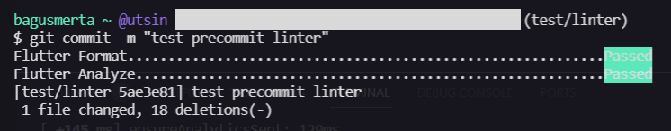

When a team moves fast, messy code slips in. Ignore it, and it piles up into tech debt that slows everyone down and causes bugs later.

The Flutter team publishes the `flutter_lints` package, a recommended set of lint rules for Flutter apps. The Dart analyzer checks your code against those rules, and you can run it yourself with `flutter analyze`. The catch is remembering to run it before every commit. In this post I'll set up a pre-commit hook that runs it for you.

### Prerequisites
1. A Flutter project.
2. Homebrew on macOS, or Python's `pip` on other platforms, to install pre-commit.

### Installation
Install pre-commit with Homebrew or pip. The [pre-commit website](https://pre-commit.com) lists other options.
```bash
brew install pre-commit  # macOS
# or
pip install pre-commit   # other platforms
```
Next, create `.pre-commit-config.yaml` in the root of your project. This file lists the hooks that run before each commit. Here's mine. It formats the code, then analyzes it.
```yaml
repos:
  - repo: local                # the hooks are defined here, not in a remote repo
    hooks:
      - id: flutter-format
        name: Flutter Format
        entry: dart format .   # command that formats the Dart files
        language: system       # use the tools already installed on your machine
        types: [dart]          # only run when Dart files change
        pass_filenames: false  # run on the whole project, not just the staged files
      - id: flutter-analyze
        name: Flutter Analyze
        entry: flutter analyze # command that analyzes the code
        language: system
        types: [dart]
        pass_filenames: false
```

Then install the hooks into your repository.
```bash
pre-commit install
```
Skip this step and nothing happens. Git only runs the hooks after `pre-commit install` adds them to `.git/hooks`.

Now add `analysis_options.yaml` to the root of your project. This file tells the Dart analyzer which rules to apply and which files to skip. Adjust the rules to fit your team.
```yaml
include: package:flutter_lints/flutter.yaml

# Lint rules on top of flutter_lints
linter:
  rules:
    avoid_empty_else: true
    avoid_print: true
    avoid_relative_lib_imports: true
    avoid_returning_null_for_void: true
    avoid_unused_constructor_parameters: true
    avoid_void_async: true
    await_only_futures: true
    camel_case_types: true
    constant_identifier_names: true
    curly_braces_in_flow_control_structures: true
    file_names: true
    no_logic_in_create_state: true
    non_constant_identifier_names: false
    prefer_const_constructors: true
    prefer_const_literals_to_create_immutables: true
    prefer_final_fields: true
    unnecessary_null_checks: true
    unnecessary_this: true
    use_key_in_widget_constructors: true

analyzer:
  exclude:  # skip generated files
    - lib/generated/**
    - "**/*.g.dart"
    - "**/*.freezed.dart"
```
> The Flutter repository has a much longer `analysis_options.yaml` if you want more rules to borrow.

### Trigger the pre-commit linter hooks

Now make a change in your project, for example inside `lib`, and commit it.
```bash
git add .
git commit -m "test precommit linter"
```
The hooks run before git creates the commit. If everything passes, each hook shows a green "Passed" label, like in the picture below.

If `flutter analyze` finds a problem, the commit stops, and the output shows which code breaks which rule. If `dart format` changes any files, the commit also stops. Fix the issues, stage your changes again, and commit.


### Conclusion
Now nobody on the team has to remember to format and analyze before committing. Unformatted code and lint errors don't get committed unless someone skips the hooks on purpose with `git commit --no-verify`.
