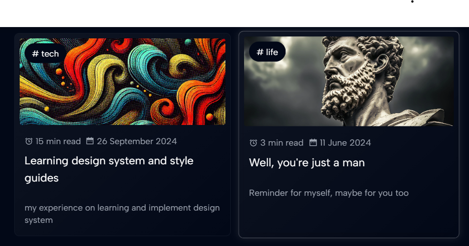

When I started in software engineering, the visual side of apps was what pulled me in, on both web and mobile. Lately I've noticed that as an app grows and more developers work on it, keeping the UI consistent gets much harder. That pushed me to learn about reusable components, style guides, and design systems.

This post covers what I learned applying a design system to this website. I've rebuilt the site many times, and each time I changed the theme and the components. The result was a site whose pages didn't match each other.

> This was my first web project, so I've probably made mistakes. If you spot one, please tell me. Also note that this post describes the site as it was in September 2024. It has been redesigned since.

## Three things you need
Based on [Lee Robinson's post](https://leerob.io/blog/style-guides-component-libraries-design-systems), there are three pieces to building a consistent UI.
1. **Style guide.** The rules every component follows. Brand colors, spacing sizes, fonts, and typefaces. When something changes, it changes inside these rules, so the design doesn't drift.
2. **Component library.** The style guide turned into reusable code. A button uses the style guide's fonts and colors, so every button matches, even when several developers build them. It also means less duplicated code.
3. **Design system.** The whole package. It includes the style guide, the component library, and the principles and documentation that explain how to use them. It's the blueprint for designing and building the app.

## Design principles
I based my principles on [Material Design](https://m3.material.io) and [Apple's Human Interface Guidelines](https://developer.apple.com/design/human-interface-guidelines/), with a few changes of my own. There are four.

**Scalability.** The system has to grow with the product and the team. Components should handle several use cases, like a button with different sizes and states such as hover and disabled, or a grid that adapts to the screen size. Adding a new component shouldn't break existing styles.

**Clarity.** Users should be able to read and understand a page easily. Use typography, color, and spacing to build a clear hierarchy, and pick legible fonts with high contrast. Clear headings, consistent icons, and even spacing between sections guide readers through the content.

**Efficiency.** Less work for users and for developers. Components should work in different situations without much customization. Predefined color and spacing tokens let developers style things without guessing values or writing extra CSS.

**Simplicity.** Keep designs simple so users don't have to think hard. Remove unnecessary elements and clutter, and use familiar patterns. A minimal interface with clear call-to-action buttons beats a heavily decorated one.

## Creating design tokens
Design tokens are named values for design decisions, like colors, fonts, font sizes, spacing, and shadows. Instead of pasting the same color value into every component, you name it `background` and define it once. Change the token, and every component that uses it changes too.

Here are the color tokens for my components. They follow the default dark theme from [shadcn/ui](https://ui.shadcn.com), with my own blue `secondary` color and card tokens added.
```css
@layer base {
  :root {
    --background: 222.2 84% 4.9%;
    --foreground: 210 40% 98%;
    --popover: 222.2 84% 4.9%;
    --popover-foreground: 210 40% 98%;
    --primary: 210 40% 98%;
    --primary-foreground: 222.2 47.4% 11.2%;
    --secondary: 217 91% 59%;
    --destructive: 0 62.8% 30.6%;
    --destructive-foreground: 210 40% 98%;
    --border: 217.2 32.6% 17.5%;
    --radius: 0.5rem;
    --card: rgba(255, 255, 255, 0.05);
    --card-hover: rgba(255, 255, 255, 0.1);
    --card-hover-border: rgba(255, 255, 255, 0.26);
  }
  ...
}
```

Most colors are stored as bare HSL numbers. In `tailwind.config.mjs`, I wrap them in `hsl()` and register them, along with fonts and border radius, so I can use them as Tailwind classes like `bg-background` or `text-primary`.

```javascript
export default {
  ...
  theme: {
    extend: {
      fontFamily: {
        primary: ['AlbertSans', ...fontFamily.sans],
        display: ['PlayfairBold', ...fontFamily.sans],
        code: ['DMMono', ...fontFamily.sans],
      },
      borderRadius: {
        lg: 'var(--radius)',
        md: 'calc(var(--radius) - 2px)',
        sm: 'calc(var(--radius) - 4px)',
      },
      colors: {
        background: 'hsl(var(--background))',
        foreground: 'hsl(var(--foreground))',
        primary: {
          DEFAULT: 'hsl(var(--primary))',
          foreground: 'hsl(var(--primary-foreground))',
        },
        secondary: 'hsl(var(--secondary))',
        destructive: {
          DEFAULT: 'hsl(var(--destructive))',
          foreground: 'hsl(var(--destructive-foreground))',
        },
        border: 'hsl(var(--border))',
      },
      ...
    },
  },
  ...
}
```

I also picked one icon set for the whole site. I find icons on [Iconify](https://iconify.design/), mostly from the open-source Simple Icons set, and render them with the `Icon` component in [Astro](https://astro.build/).
```astro
---
const icon = 'simple-icons:github';
---
<Icon class='text-2xl text-gray-400' name={icon} />
```
Sticking to one icon set keeps the icons consistent across the site.

## Building the component library
With the tokens in place, I built the components on top of them, following the principles above.

The button has two variants, primary and secondary. The primary button also has a glowing version.

```astro
<PrimaryButton href="" text="Glowing" glowing={true} />
<PrimaryButton href="" text="Primary" />
<SecondaryButton href="" text="Secondary" />
```
Here's how they look.


Cards are separate components, one per type of content, because each type shows different information. They all use the same tokens. Here's the blog card.

```astro
---
import type { BlogEntry } from "utils/content";
import { formatDate } from "utils/time";
import { getBlogPathName } from "utils/url";
import { Icon } from "astro-icon/components"
import { Image } from "astro:assets";
export type Props = BlogEntry;

const props = Astro.props;
---
<li class:list={[
  'p-2 w-full rounded-lg border border-gray-900',
  'bg-gradient-to-br from-[var(--card)]',
  'hover:scale-[1.02] active:scale-[0.97] motion-safe:transform-gpu',
  'transition duration-500',
  'motion-reduce:hover:scale-100',
  'animate-shadow',
  'hover:border-[var(--card-hover-border)] hover:shadow-[0_0_12px_var(--card-hover)]',
]}>
 ...
</li>
```
The card uses `--card` for its background, and `--card-hover` and `--card-hover-border` for its hover state, so every card looks the same. For users who turn on reduced motion, `motion-reduce:hover:scale-100` turns off the hover zoom.

Here's how it looks.


## Conclusion
The site now has a base to build on. When I change something or add a feature, I start from the tokens and components instead of restyling pages one by one.

References.

[Lee Robinson on style guides, component libraries, and design systems](https://leerob.io/blog/style-guides-component-libraries-design-systems)

[Basic UI fundamentals by Theodorus Clarence](https://theodorusclarence.com/blog/btb-ui-fundamental)

[Apple Human Interface Guidelines](https://developer.apple.com/design/human-interface-guidelines/)

[Material Design 3](https://m3.material.io)
